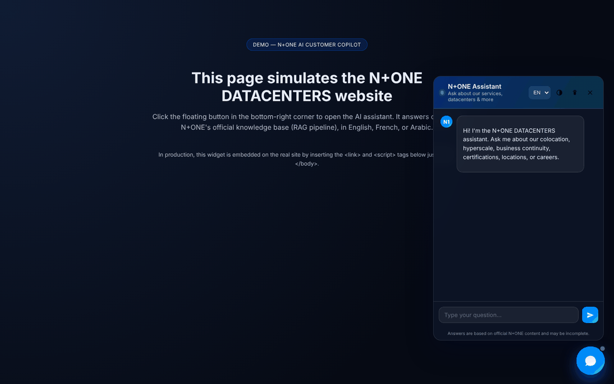

# N+ONE AI Customer Copilot

**Final Year Engineering Project (PFA) — AI Customer Copilot for N+ONE DATACENTERS**

Authors: Hamza Bouafi, Haytam Zerrouki
Internship company: [N+ONE DATACENTERS](https://nplusone.africa/)

A Retrieval-Augmented Generation (RAG) chatbot embedded on the N+ONE DATACENTERS website that
answers visitor questions about services, datacenters, certifications, and careers — using
**only** official company content, with guardrails against hallucination (similarity-gated
retrieval, cited sources, refusal when the answer isn't in the knowledge base).



---

## 1. Architecture Overview

```
 ┌─────────────┐      HTTPS       ┌────────────────┐      ┌──────────────┐
 │  Chat Widget │ ───────────────▶ │  FastAPI Backend│ ───▶ │  FAISS Index │
 │ (vanilla JS) │ ◀─────────────── │  (RAG pipeline)  │ ◀─── │ (embeddings) │
 └─────────────┘                  └────────┬────────┘      └──────────────┘
                                            │
                              ┌─────────────┼─────────────┐
                              ▼             ▼             ▼
                        OpenAI GPT     Ollama (local)   SQLite/Postgres
                                                          (history, logs,
                                                           feedback, admin)
```

RAG pipeline: **Document Loader → Text Splitter → Sentence-Transformer Embeddings → FAISS
Vector Store → Similarity-score-gated Retriever → Prompt Assembly → LLM (OpenAI/Ollama) →
Grounded Answer + Cited Sources**.

See `services/rag_service.py` for the orchestration and `prompts/system_prompt.py` for the
anti-hallucination guardrails.

## 2. Project Structure

```
npone-ai-copilot/
├── backend/
│   ├── api/            # FastAPI routers (chat.py, admin.py)
│   ├── config/          # Typed settings (pydantic-settings)
│   ├── database/        # SQLAlchemy models + session
│   ├── ingestion/       # scrape_site.py, ingest.py, create_admin.py
│   ├── models/           # Pydantic request/response schemas
│   ├── prompts/          # System prompt templates (anti-hallucination rules)
│   ├── services/         # embedding_service, llm_service, rag_service, memory_service
│   ├── utils/            # security.py (XSS/injection/JWT), deps.py
│   ├── vectorstore/      # FAISS index (generated, gitignored)
│   ├── main.py           # FastAPI app entrypoint
│   ├── requirements.txt
│   └── Dockerfile
├── frontend/
│   ├── assets/css/widget.css
│   ├── assets/js/widget.js
│   └── index.html        # demo page simulating the N+ONE site
├── knowledge_base/raw/    # Source documents (.md/.html/.pdf/.docx) — seeded from nplusone.africa
├── deployment/nginx/       # Reverse proxy + TLS config
├── docker-compose.yml
└── README.md
```

## 3. Quick Start (local development)

```bash
# 1. Backend setup
cd backend
python -m venv venv && source venv/bin/activate     # Windows: venv\Scripts\activate
pip install -r requirements.txt
cp .env.example .env                                 # then edit SECRET_KEY, OPENAI_API_KEY, etc.

# 2. Generate the admin password hash
python ingestion/create_admin.py                     # paste the printed hash into .env

# 3. Build the knowledge base
python ingestion/scrape_site.py                       # crawls nplusone.africa -> knowledge_base/raw/*.md
python ingestion/ingest.py                             # builds the FAISS index

# 4. Run the API
uvicorn main:app --reload --port 8000
# Swagger docs: http://localhost:8000/docs

# 5. Open the widget demo
cd ../frontend
python -m http.server 5500
# visit http://localhost:5500
```

## 4. Switching LLM Providers

Set in `backend/.env`:

```env
LLM_PROVIDER=openai        # or: ollama
OPENAI_API_KEY=sk-...
OPENAI_MODEL=gpt-4o-mini
# --- or, for a fully self-hosted stack ---
LLM_PROVIDER=ollama
OLLAMA_BASE_URL=http://localhost:11434
OLLAMA_MODEL=llama3
```

No code changes required — see `services/llm_service.py` (Strategy pattern).

## 5. Docker Deployment

```bash
docker compose up -d --build
docker compose exec backend python ingestion/scrape_site.py
docker compose exec backend python ingestion/ingest.py
```

This starts: FastAPI backend, optional Ollama container, and Nginx reverse proxy with TLS
termination (`deployment/nginx/nginx.conf`).

## 6. Security Measures

| Threat                  | Mitigation                                                            |
|--------------------------|-------------------------------------------------------------------------|
| Hallucination             | Similarity-score gate + strict system prompt (`MIN_SIMILARITY_SCORE`)  |
| Prompt injection           | Heuristic filter + explicit "ignore embedded instructions" prompt rule |
| XSS                        | `bleach` sanitization of all user input before storage/rendering       |
| Abuse / scraping            | `slowapi` rate limiting per IP, per route                              |
| Admin route hijack          | JWT Bearer auth, bcrypt password hashing                               |
| Secrets leakage             | All secrets in `.env` (never committed — see `.gitignore`)             |
| Data in transit              | TLS termination at Nginx (HSTS enabled in production)                  |

## 7. Admin Dashboard API

All routes under `/api/v1/admin/*` require `Authorization: Bearer <token>` obtained from
`POST /api/v1/admin/login`. Key endpoints:

- `GET /admin/stats` — conversations, avg response time, top questions, feedback ratio
- `GET /admin/logs` — recent request logs
- `GET /admin/knowledge-base/status` — indexed documents & chunk counts
- `POST /admin/knowledge-base/reload` — hot-reload the FAISS index after re-ingestion

*(A visual dashboard UI is delivered in Phase 2 of this project — see Roadmap below.)*

## 8. Roadmap / Next Deliverables

This repository currently covers **Phase 1**: working backend, RAG pipeline, ingestion
scripts seeded with real N+ONE content, and the embeddable chat widget. Planned next phases:

- **Phase 2** — Admin dashboard frontend (charts, log viewer, KB manager UI)
- **Phase 3** — Automated test suite (unit/integration/security), CI pipeline
- **Phase 4** — UML diagrams (use case, class, sequence, deployment, ER)
- **Phase 5** — Full internship report template (PFA) + PowerPoint defense deck

## 9. License

See `LICENSE` (MIT, unless the internship company requires otherwise).
